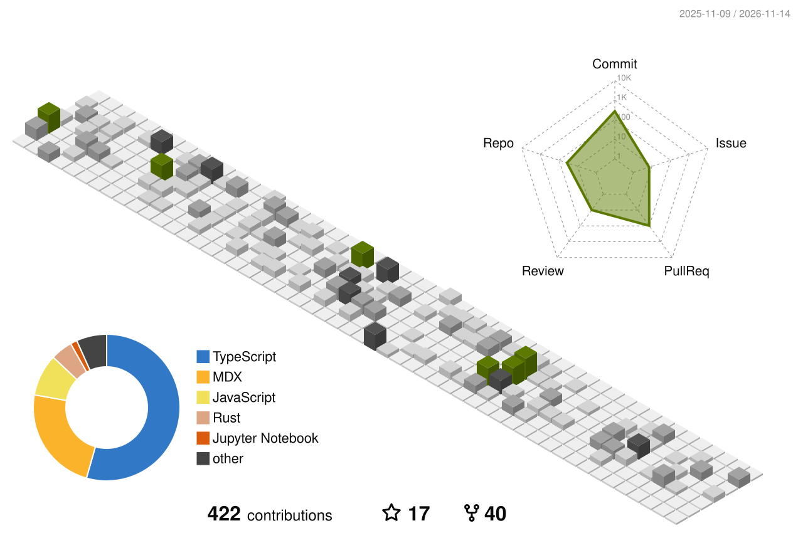

<picture>
  <source media="(prefers-color-scheme: dark)" srcset="https://raw.githubusercontent.com/matiasbenary/matiasbenary/output/hero-dark.svg">
  
</picture>

  <a href="https://linkedin.com/in/matiasbenary"><picture><source media="(prefers-color-scheme: dark)" srcset="https://raw.githubusercontent.com/matiasbenary/matiasbenary/output/social-linkedin-dark.svg"></picture></a>
  <a href="https://x.com/MatiasBenary"><picture><source media="(prefers-color-scheme: dark)" srcset="https://raw.githubusercontent.com/matiasbenary/matiasbenary/output/social-x-dark.svg"></picture></a>
  <a href="https://neardev.substack.com"><picture><source media="(prefers-color-scheme: dark)" srcset="https://raw.githubusercontent.com/matiasbenary/matiasbenary/output/social-substack-dark.svg"></picture></a>
  <a href="mailto:matiasbenary@gmail.com"><picture><source media="(prefers-color-scheme: dark)" srcset="https://raw.githubusercontent.com/matiasbenary/matiasbenary/output/social-gmail-dark.svg"></picture></a>

I'm a fullstack engineer from Buenos Aires, ten years in, mostly TypeScript, React and Node. Today I work on **Developer Experience at [NEAR Protocol](https://near.org)**: I build the tooling, example apps and the Ask AI assistant behind [docs.near.org](https://docs.near.org), and ship features from the database to the UI.

Over the last 12 months I've been the [#1 contributor to near/docs](https://github.com/near/docs/pulls?q=is%3Apr+is%3Amerged+author%3Amatiasbenary) by merged PRs (43, more than any other author), on top of 228 merged pull requests across open source, most of them in repos I don't own: near-api-js, create-near-app, hello-near-examples, nearai/ironclaw. Before that I led the migration of [Fonselp](https://fonselp.org)'s legacy Laravel platform to Node and React; 7,500+ organizations use it. I write a weekly newsletter on NEAR internals at [neardev.substack.com](https://neardev.substack.com).

### Things I've built

  <a href="https://github.com/matiasbenary/near-stake"><picture><source media="(prefers-color-scheme: dark)" srcset="https://raw.githubusercontent.com/matiasbenary/matiasbenary/output/repo-near-stake-dark.svg"></picture></a>
   
  <a href="https://github.com/matiasbenary/near-connect-hooks"><picture><source media="(prefers-color-scheme: dark)" srcset="https://raw.githubusercontent.com/matiasbenary/matiasbenary/output/repo-near-connect-hooks-dark.svg"></picture></a>
   
  <a href="https://github.com/matiasbenary/outlayer-mock"><picture><source media="(prefers-color-scheme: dark)" srcset="https://raw.githubusercontent.com/matiasbenary/matiasbenary/output/repo-outlayer-mock-dark.svg"></picture></a>

### What I build with

<picture>
  <source media="(prefers-color-scheme: dark)" srcset="https://raw.githubusercontent.com/matiasbenary/matiasbenary/output/stack-dark.svg">
  
</picture>

### Activity

<picture>
  <source media="(prefers-color-scheme: dark)" srcset="https://raw.githubusercontent.com/matiasbenary/matiasbenary/output/stats-dark.svg">
  
</picture>

<picture>
  <source media="(prefers-color-scheme: dark)" srcset="https://raw.githubusercontent.com/matiasbenary/matiasbenary/output/contrib-3d-dark.svg">
  
</picture>

<b>My path so far</b>

 

| Year | Milestone |
| --- | --- |
| 2015 | Joined Supryme (acquired by Visa, now Prisma Medios de Pago); PHP and Laravel developer from 2016 |
| 2018 | Tech Lead at Fonselp; led the migration from Laravel to Node and React, used today by 7,500+ organizations |
| 2019 | Frontend instructor at Ada ITW, where I taught the bootcamp for three years |
| 2023 | Software Engineer, Developer Experience at NEAR Protocol |
| 2024 | Graduated as Computer Engineer at Universidad Nacional Arturo Jauretche |
| 2025 | Built the Ask AI assistant on docs.near.org; lecturer in Algorithms and Programming at UNAJ |
| 2026 | #1 contributor to near/docs by merged PRs over the last 12 months; shipped streaming chat in the docs search bar |
| Along the way | 228 merged PRs across open source and a weekly newsletter on NEAR internals |

Open to remote fullstack roles, LATAM to US/EU. Stats refresh daily with GitHub Actions; the SVGs are generated by <code>scripts/build.mjs</code>.

